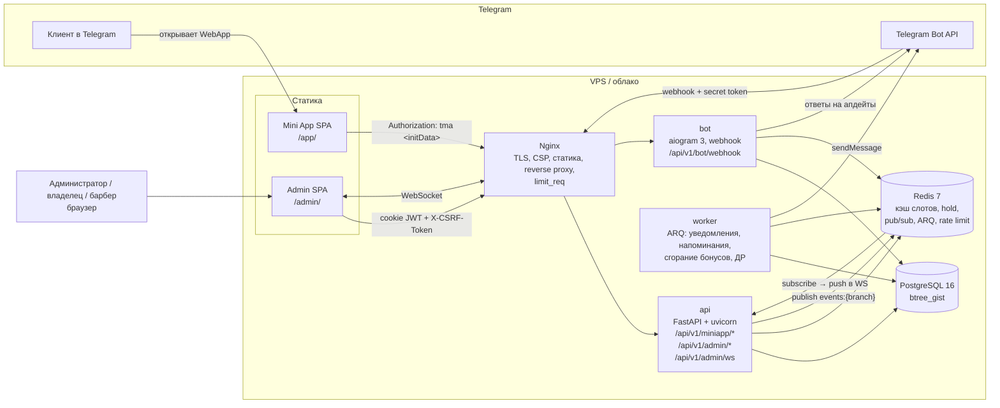

# Архитектура: онлайн-запись в барбершоп

Этап 1 из 9. Схема компонентов, модель данных, API, ключевые решения и компромиссы.

## 0. Данные салона (зафиксировано)

| Параметр | Значение |
|---|---|
| Город / таймзона | Бишкек, `Asia/Bishkek` (UTC+6, без DST) |
| Валюта | KGS; все суммы хранятся в **тыйынах** (`BIGINT`, 1 сом = 100 тыйын) |
| Языки | `ru` (по умолчанию), `ky`, `en` — Mini App, админка, бот |
| Онлайн-оплата | Нет. Оплата в салоне, админ отмечает способ оплаты (`cash`/`card`/`transfer`/`mixed`) |
| Масштаб | Один салон, но в модели заложены филиалы (`branches`, `branch_id` во всех «салонных» таблицах) |
| Название | Задаётся в `salon_settings.name` (в сидах — плейсхолдер `Barbershop`) |

---

## 1. Схема компонентов



**Процессы** — один Python-пакет `backend/app`, один Docker-образ, три entrypoint'а:

| Процесс | Команда | Роль |
|---|---|---|
| `api` | `uvicorn app.main:app` | REST + WebSocket админки |
| `bot` | `uvicorn app.bot.main:app` | Приём вебхуков Telegram, команды `/start`, приём контакта, callback-кнопки |
| `worker` | `arq app.worker.WorkerSettings` | Отправка сообщений (outbox), напоминания, cron-задачи бонусов |

Для CI/CD образов четыре: `backend` (используется api/bot/worker с разными командами — по ТЗ можно тегировать как три образа из одного Dockerfile с разными `CMD`), `nginx` (со статикой обоих фронтов).

**Почему бот — отдельный процесс, а не роутер внутри api:** всплеск апдейтов или зависший хэндлер не влияет на latency API; бот можно рестартить/масштабировать независимо. Отправка исходящих сообщений идёт **только через worker** (outbox) — API никогда не ходит в Telegram синхронно в запросе пользователя.

### Слои бэкенда

```
routers (FastAPI, DTO Pydantic)  →  services (бизнес-логика, транзакции, mypy strict)
                                 →  repositories (SQLAlchemy async, только запросы)
domain/ (чистые функции без IO: slots.py, pricing.py, bonus_math.py) — 100% юнит-тестов
```

Алгоритм слотов и расчёт бонусов/суммы — чистые функции в `domain/`, сервис только загружает данные одним-двумя запросами и передаёт их туда. Это даёт быстрые детерминированные тесты без БД.

### Структура репозитория

```
/backend
  app/
    api/v1/{miniapp,admin,bot}/   роутеры
    services/  repositories/  domain/  models/  schemas/
    core/      (config, security, initdata, jwt, csrf, errors, logging, redis, db)
    bot/       (aiogram dispatcher, handlers, keyboards, i18n)
    worker/    (arq jobs, cron)
    i18n/      (ru.ftl / ky / en — тексты бота и уведомлений по умолчанию)
  alembic/  tests/  pyproject.toml
/apps/miniapp        React + Vite + tma.js
/apps/admin          React + Vite + shadcn/ui
/packages/api-client openapi-typescript + openapi-fetch, генерация из openapi.json
/packages/ui         money/date форматтеры, общие zod-схемы, i18n-ключи
/infra               docker/, nginx/, compose.{dev,prod}.yml
/.github/workflows
/docs
```

---

## 2. ER-диаграмма

```mermaid
erDiagram
    branches ||--|| salon_settings : has
    branches ||--|| bonus_settings : has
    branches ||--o{ barbers : employs
    branches ||--o{ loyalty_levels : defines
    branches ||--o{ bookings : hosts

    users ||--o| clients : "telegram identity"
    clients ||--o{ bookings : makes
    clients ||--o{ bonus_transactions : owns
    clients }o--o| loyalty_levels : "current level"
    clients }o--o| clients : "referred_by"

    admin_users }o--o| barbers : "role=barber → own barber"
    admin_users }o--o| users : "Telegram Login / уведомления"
    admin_users ||--o{ admin_refresh_tokens : sessions

    barbers ||--o{ barber_schedules : "weekly template"
    barbers ||--o{ barber_schedule_exceptions : "days off / vacation / custom"
    barbers ||--o{ barber_services : performs
    services ||--o{ barber_services : "price/duration override"
    service_categories ||--o{ services : groups

    barbers ||--o{ bookings : serves
    bookings ||--o{ booking_services : includes
    services ||--o{ booking_services : snapshot
    bookings ||--o{ booking_reminders : "sent reminders"
    bookings ||--o{ bonus_transactions : "earn / spend / refund"

    bonus_transactions ||--o{ bonus_lot_consumptions : "lot (credit)"
    bonus_transactions ||--o{ bonus_lot_consumptions : "consumer (spend/expire)"

    notifications ||--o{ notification_reads : "read by admin"
    admin_users ||--o{ notification_reads : reads
    telegram_outbox }o--o| bookings : about
    audit_log }o--o| admin_users : actor

    branches {
        uuid id PK
        text name
        bool is_active
    }
    salon_settings {
        uuid branch_id PK,FK
        text name
        text timezone "Asia/Bishkek"
        char3 currency "KGS"
        text default_language "ru"
        smallint slot_step_min "15"
        smallint buffer_min "0..60"
        int min_lead_time_min
        smallint max_days_ahead
        smallint cancel_min_hours
        smallint reschedule_min_hours
        smallint max_active_bookings_per_client
        bool auto_confirm
        int_arr reminder_offsets_min "[1440,120]"
        bigint admin_chat_id
        bool notify_barbers
        jsonb notification_templates "{key:{ru,ky,en}}"
        jsonb contacts "address, phone, map"
    }
    users {
        uuid id PK
        bigint telegram_id UK
        text username
        text first_name
        text last_name
        text language_code
        text photo_url
        bool bot_blocked "403 от Bot API"
    }
    clients {
        uuid id PK
        uuid branch_id FK
        uuid user_id FK,UK "NULL для клиентов по звонку"
        text name
        text phone "E.164, index"
        date birthday
        text[] tags
        text notes
        bool is_blocked
        uuid level_id FK
        bigint bonus_balance "кэш ledger"
        bigint total_spent "оплачено, тыйын"
        int visits_count
        int no_show_count
        text referral_code UK
        uuid referred_by_client_id FK
        timestamptz created_at
    }
    admin_users {
        uuid id PK
        text login UK
        text password_hash "argon2id"
        text role "owner|admin|barber"
        uuid barber_id FK
        uuid user_id FK
        text language
        bool is_active
        timestamptz last_login_at
    }
    admin_refresh_tokens {
        uuid id PK
        uuid admin_user_id FK
        uuid family_id
        text token_hash UK
        timestamptz expires_at
        timestamptz used_at "reuse detection"
        timestamptz revoked_at
    }
    barbers {
        uuid id PK
        uuid branch_id FK
        text name
        text photo_url
        jsonb specialization_i18n
        jsonb bio_i18n
        smallint rating_x100
        int rating_count
        smallint sort_order
        bool is_active
        bool is_bookable_online
    }
    barber_schedules {
        uuid id PK
        uuid barber_id FK
        smallint weekday "0=Mon"
        time start_time
        time end_time "<= start → следующий день"
    }
    barber_schedule_exceptions {
        uuid id PK
        uuid barber_id FK
        date date_from "локальная дата"
        date date_to
        text kind "day_off|vacation|custom_hours"
        jsonb intervals "[{start,end}] для custom_hours"
        text note
    }
    service_categories {
        uuid id PK
        uuid branch_id FK
        jsonb name_i18n
        smallint sort_order
    }
    services {
        uuid id PK
        uuid branch_id FK
        uuid category_id FK
        jsonb name_i18n
        jsonb description_i18n
        smallint duration_min
        bigint base_price
        bool is_active
        smallint sort_order
    }
    barber_services {
        uuid barber_id PK,FK
        uuid service_id PK,FK
        bigint price "NULL → base_price"
        smallint duration_min "NULL → base"
        bool is_active
    }
    bookings {
        uuid id PK
        uuid branch_id FK
        uuid client_id FK "NULL для kind=block"
        uuid barber_id FK
        text kind "appointment|block"
        text status "pending|confirmed|completed|cancelled|no_show"
        text source "miniapp|admin|bot"
        timestamptz start_at
        timestamptz end_at
        timestamptz blocked_until "end_at + buffer"
        bigint subtotal
        bigint bonus_spent
        bigint total_due "subtotal - bonus_spent"
        bigint paid_amount
        text payment_method
        text comment
        text admin_note
        text idempotency_key
        uuid created_by_admin_id FK
        text cancel_reason
        text cancelled_by "client|admin|system"
        timestamptz cancelled_at
        int version "optimistic lock"
        timestamptz created_at
        timestamptz updated_at
    }
    booking_services {
        uuid id PK
        uuid booking_id FK
        uuid service_id FK
        jsonb name_snapshot
        smallint duration_min
        bigint price
        smallint position
    }
    booking_reminders {
        uuid booking_id PK,FK
        int offset_min PK
        timestamptz sent_at
    }
    bonus_settings {
        uuid branch_id PK,FK
        bool enabled
        int base_cashback_bp "basis points: 500 = 5%"
        int max_spend_bp
        int lifetime_days
        text level_rule "any|all"
        bool welcome_enabled
        bigint welcome_amount
        bool birthday_enabled
        bigint birthday_amount
        smallint birthday_days_before
        bool referral_enabled
        bigint referrer_amount
        bigint referee_amount
        smallint expiry_warning_days "3"
    }
    loyalty_levels {
        uuid id PK
        uuid branch_id FK
        jsonb name_i18n
        bigint min_spent "тыйын"
        int min_visits
        int cashback_bp
        text color
        smallint sort_order
    }
    bonus_transactions {
        uuid id PK
        uuid client_id FK
        text type "earn|spend|expire|refund|manual|referral|welcome|birthday"
        bigint amount "со знаком"
        bigint balance_after
        uuid booking_id FK
        timestamptz expires_at "для кредитов"
        text comment "обязателен для manual"
        uuid created_by_admin_id FK
        text dedupe_key UK "earn:booking:..., birthday:client:2026"
        timestamptz created_at
    }
    bonus_lot_consumptions {
        uuid id PK
        uuid lot_tx_id FK "кредитная транзакция"
        uuid consumer_tx_id FK "spend|expire|manual-"
        bigint amount
    }
    notifications {
        uuid id PK
        uuid branch_id FK
        text type "booking_created|cancelled|rescheduled|..."
        uuid booking_id FK
        jsonb payload
        timestamptz created_at
    }
    notification_reads {
        uuid notification_id PK,FK
        uuid admin_user_id PK,FK
        timestamptz read_at
    }
    telegram_outbox {
        uuid id PK
        bigint chat_id
        text template_key
        jsonb payload
        text status "pending|sent|failed|dead"
        smallint attempts
        timestamptz send_after
        timestamptz sent_at
        text last_error
        text dedupe_key UK
    }
    audit_log {
        bigint id PK
        text actor_type "admin|client|system"
        uuid actor_id
        text action
        text entity_type
        uuid entity_id
        jsonb before
        jsonb after
        inet ip
        text request_id
        timestamptz created_at
    }
```



### Ключевые ограничения БД

```sql
CREATE EXTENSION IF NOT EXISTS btree_gist;

ALTER TABLE bookings ADD CONSTRAINT bookings_no_overlap
  EXCLUDE USING gist (
    barber_id WITH =,
    tstzrange(start_at, blocked_until, '[)') WITH &&
  ) WHERE (status IN ('pending', 'confirmed'));

-- идемпотентность
CREATE UNIQUE INDEX ux_bookings_idem ON bookings (client_id, idempotency_key)
  WHERE idempotency_key IS NOT NULL;

-- целостность
CHECK (end_at > start_at AND blocked_until >= end_at)
CHECK (kind = 'block' OR client_id IS NOT NULL)
CHECK (total_due = subtotal - bonus_spent AND bonus_spent >= 0)

-- бонусы: одно начисление на запись, один ДР-бонус в год, один welcome
UNIQUE (dedupe_key)
```

Все `timestamptz` в UTC. Даты исключений расписания (`date_from/date_to`) и `time` в шаблоне — **локальные** для таймзоны салона (так их вводит админ), в UTC переводятся в алгоритме слотов.

---

## 3. API (`/api/v1`)

Единый формат ошибки (все 4xx/5xx):

```json
{ "error": { "code": "slot_conflict", "message": "Это время уже занято",
             "details": { "alternatives": ["2026-11-14T09:30:00Z"] },
             "request_id": "01JC..." } }
```

Пагинация: cursor-based для лент (`?cursor=&limit=`), offset/limit + `total` для таблиц админки (TanStack Table серверная пагинация).

### Mini App — `/miniapp/*` (заголовок `Authorization: tma <initData>`)

| Метод | Путь | Описание |
|---|---|---|
| GET | `/me` | Профиль клиента; при первом вызове создаёт `users`+`clients`, применяет `startapp=ref_xxx`, welcome-бонус |
| PATCH | `/me` | Имя, язык, день рождения |
| POST | `/me/phone` | Подписанный контакт из `requestContact` (валидируется тем же HMAC) |
| GET | `/salon` | Публичные настройки: название, tz, валюта, правила отмены, контакты |
| GET | `/barbers?service_ids=` | Мастера (фильтр «кто выполняет все выбранные услуги») |
| GET | `/services?barber_id=` | Услуги с ценой/длительностью для мастера; для «любого» — диапазон цен `min..max` |
| GET | `/availability/days?barber_id\|any&service_ids&from&to` | Дни, в которых есть хотя бы один слот (для календаря) |
| GET | `/availability/slots?date&barber_id\|any&service_ids` | Слоты дня |
| POST | `/holds` | Hold слота на 5 мин; для «любого» назначает мастера; возвращает `hold_id`, мастера, расчёт (subtotal, баланс, max списания) |
| DELETE | `/holds/{id}` | Снять hold (BackButton с экрана подтверждения) |
| POST | `/bookings` | Создание. `Idempotency-Key` обязателен. 409 → `alternatives` |
| GET | `/bookings?scope=upcoming\|past` | Мои записи |
| GET | `/bookings/{id}` | Деталь (IDOR: фильтр по `client_id`) |
| POST | `/bookings/{id}/cancel` | Отмена (проверка `cancel_min_hours`), возврат бонусов |
| POST | `/bookings/{id}/reschedule` | Перенос `{hold_id}` (проверка `reschedule_min_hours`) |
| GET | `/bookings/repeat` | Черновик «как в прошлый раз»: мастер + услуги + ближайшие слоты |
| GET | `/bonus` | Баланс, уровень, прогресс до следующего, сгорающие в ближайшие дни |
| GET | `/bonus/transactions` | История |
| GET | `/referral` | Код и ссылка `t.me/<bot>/<app>?startapp=ref_<code>` |

### Админка — `/admin/*` (JWT cookie + CSRF + RBAC)

| Группа | Эндпоинты | Роли |
|---|---|---|
| Auth | `POST /auth/login`, `POST /auth/refresh`, `POST /auth/logout`, `GET /auth/me`, `POST /auth/telegram` (опц.) | все |
| Дашборд | `GET /dashboard?period=day\|week\|month` | owner, admin |
| Мастера | CRUD `/barbers`, `POST /barbers/{id}/photo`, `PUT /barbers/{id}/schedule`, CRUD `/barbers/{id}/exceptions`, `PUT /barbers/{id}/services` | owner, admin (barber — read своего) |
| Услуги | CRUD `/service-categories`, CRUD `/services` | owner, admin |
| Клиенты | `GET /clients` (поиск, теги, уровень), `GET/PATCH /clients/{id}`, `POST /clients/{id}/block`, `GET /clients/{id}/bookings`, `GET /clients/{id}/bonus`, `POST /clients/{id}/bonus/adjust` | owner, admin |
| Записи | `GET /bookings` (фильтры), `GET /calendar?from&to&barber_ids`, `POST /bookings` (по звонку), `GET/PATCH /bookings/{id}` (услуги, суммы, оплата; `If-Match: version`), `POST /bookings/{id}/status`, `POST /bookings/{id}/move` (DnD: barber_id, start_at), `POST /blocks`, `DELETE /blocks/{id}`, `GET /availability/slots` | owner, admin; barber — свои, read + статус completed/no_show |
| Финансы | `GET /finance/summary`, `/finance/by-barber`, `/finance/by-service`, `GET /finance/export?format=csv\|xlsx` | owner, admin |
| Настройки | `GET/PUT /settings/salon` | owner, admin |
| Бонусы | `GET/PUT /settings/bonus`, CRUD `/loyalty-levels` | owner |
| Сотрудники | CRUD `/admin-users` | owner |
| Уведомления | `GET /notifications`, `GET /notifications/unread-count`, `POST /notifications/{id}/read`, `POST /notifications/read-all` | все |
| Аудит | `GET /audit-log` | owner |
| Real-time | `WS /admin/ws` | все (фильтр событий по роли) |

### Прочее

| Метод | Путь | Описание |
|---|---|---|
| POST | `/bot/webhook` | Telegram, проверка `X-Telegram-Bot-Api-Secret-Token` (constant-time), дедуп по `update_id` |
| GET | `/health/live`, `/health/ready` | liveness; readiness проверяет Postgres и Redis |

Rate limiting (Redis, sliding window): `POST /miniapp/holds` 20/мин, `POST /miniapp/bookings` 5/мин и 20/сутки на клиента; `POST /admin/auth/login` 5/мин на IP+login. Плюс `limit_req` в Nginx как внешний периметр.

---

## 4. Ключевые решения

### 4.1 Авторизация

**Mini App.** Каждый запрос несёт `Authorization: tma <initData>`. Бэкенд: парсит query string, вычисляет `secret = HMAC_SHA256(key="WebAppData", msg=bot_token)`, `hash = HMAC_SHA256(secret, data_check_string)`, сравнивает через `hmac.compare_digest`, проверяет `auth_date` (TTL по умолчанию 24 ч, настраивается). Без сессий и JWT — валидация дешёвая (микросекунды), stateless. Результат кэшируется в рамках запроса (dependency). Клиент с `is_blocked` получает 403.

**Телефон.** `requestContact()` из tma.js возвращает подписанную строку контакта — её валидируем тем же алгоритмом на `POST /me/phone`. Параллельно бот получает сообщение `contact` и тоже сохраняет номер (fallback, если Mini App закрылась).

**Админка.** Логин/пароль (argon2id) → `access` JWT (15 мин) и `refresh` (30 дней) в `httpOnly; Secure; SameSite=Strict` cookie, `refresh` с `Path=/api/v1/admin/auth`. Ротация refresh: каждый refresh выдаёт новый токен в той же `family_id`; повторное использование старого → отзыв всей семьи (reuse detection). CSRF: double-submit — неhttpOnly cookie `csrf_token` + заголовок `X-CSRF-Token` на всех мутирующих запросах. WebSocket: auth по cookie + проверка `Origin`. RBAC — декларативная зависимость `require_roles(...)` + проверка владения для `barber` (только `barber_id == own`). Фронт получает `permissions[]` в `/auth/me` и скрывает недоступные действия.

### 4.2 Алгоритм свободных слотов

Чистая функция `domain/slots.py::compute_slots(...)`:

1. **Рабочие интервалы дня** для мастера: шаблон по дню недели **или** исключение (`day_off`/`vacation` → пусто, `custom_hours` → свои интервалы). Перерыв = промежуток между интервалами шаблона (шаблон хранит несколько интервалов на день: 10:00–14:00, 15:00–21:00). Локальное время → UTC через `zoneinfo` для конкретной даты (корректно на DST). `end_time <= start_time` → интервал заканчивается на следующие сутки (ночные смены); интервал вчерашней ночной смены тоже попадает в сегодняшний день.
2. **Занятость**: записи (`start_at`, `blocked_until`) со статусом pending/confirmed, блоки (`kind=block`), чужие hold'ы из Redis — всё сливается в один отсортированный список и мерджится (перекрывающиеся объединяются).
3. **Проход двумя указателями**: кандидаты `t` по сетке `slot_step_min`, выровненной от начала рабочего интервала; слот валиден, если `[t, t + duration + buffer)` ⊆ рабочего интервала и не пересекается с текущим busy-интервалом. Указатель по busy только двигается вперёд → **O(S + B)** на мастера и день.
4. Отсечение: `t < now + min_lead_time` и дни за пределами `max_days_ahead`.

Буфер: последний клиент дня не требует буфера после себя? Решение — **требует** (строгое правило из ТЗ: `[start, start+duration+buffer)` в рабочем времени). Флаг `buffer_at_day_end` можно добавить позже.

**Данные одним запросом**: для диапазона дат и набора мастеров — один запрос записей (`barber_id = ANY(:ids) AND start_at < :to AND blocked_until > :from`), один — шаблонов, один — исключений, один — `barber_services`. Никаких N+1.

**«Любой мастер»**: кандидаты — мастера, у которых активны *все* выбранные услуги; длительность считается **по каждому мастеру отдельно** (у мастера могут быть свои длительности). Результат — объединение слотов `{time → [barber_ids]}`. При `POST /holds` мастер выбирается среди свободных в этот момент по правилу: минимум забронированных минут за этот день → меньше записей → `sort_order`.

**Кэш**: результат на (мастер, дата, длительность) в Redis на 60 с, ключ включает `version:{barber}:{date}`, который инкрементируется при любом изменении записей/расписания мастера. Hold'ы не кэшируются (вычитаются поверх).

### 4.3 Защита от двойного бронирования — три уровня

1. **Redis hold (UX-уровень).** `POST /holds` выполняет Lua-скрипт атомарно: проверяет пересечение с чужими hold'ами мастера на этот день (ZSET по началу + HASH деталей), добавляет hold с TTL 5 мин. Клиент видит, что слот «за ним», пока на экране подтверждения. Свои hold'ы клиента при новом hold'е снимаются (один активный hold на клиента).
2. **PostgreSQL EXCLUDE constraint (истина).** `INSERT` при конфликте падает с `ExclusionViolationError` → сервис возвращает **409 `slot_conflict`** с 3–5 ближайшими альтернативами. Redis может упасть или hold истечь — БД всё равно не пустит пересечение.
3. **Идемпотентность.** `Idempotency-Key` (UUID v4 с фронта, один на попытку подтверждения). Redis `idem:{client}:{key}` → сохранённый ответ (24 ч) + уникальный индекс в БД на случай гонки/сброса Redis. Повтор с тем же ключом возвращает ту же запись (200), с другим телом — 422.

Запись создаётся в одной транзакции: INSERT booking + booking_services + списание бонусов (ledger, `FOR UPDATE` клиента) + `notifications` + `telegram_outbox` + `audit_log`. После COMMIT — `PUBLISH events:{branch}` и `enqueue send_outbox`. Если publish/enqueue потеряны — outbox-поллер в worker'е (каждые 10 с) досылает.

Перенос админом (DnD) — `UPDATE` того же ряда под тем же constraint'ом + `If-Match: version` против одновременного редактирования двумя админами (412 при расхождении).

### 4.4 Бонусная система

- **Ledger append-only** (`bonus_transactions`), `clients.bonus_balance` — кэш, обновляется в той же транзакции после `SELECT ... FROM clients WHERE id = :id FOR UPDATE`. Ночная задача-сверка (сумма ledger = кэш), расхождения → лог + Sentry.
- **FIFO по сгоранию** без мутации ledger: кредитные транзакции (earn/welcome/referral/birthday/manual+/refund) — это «лоты» с `expires_at`; расход фиксируется строками `bonus_lot_consumptions` (лот → потребитель, сумма). Остаток лота = amount − Σ consumptions. Списание берёт лоты по `expires_at ASC NULLS LAST`.
- **Проценты — в basis points** (`int`, 500 = 5 %), округление вниз до тыйына целочисленной арифметикой: `amount * bp // 10_000`. Никаких float/Decimal в бизнес-логике.
- **Списание** — при создании записи (`spend`, лимит `min(balance, subtotal * max_spend_bp // 10000)`). **Отмена/no_show** → `refund`: возвращает в исходные лоты с исходным `expires_at` (если лот уже сгорел — новый лот со сроком `now + 7 дней`). Если админ при закрытии уменьшил сумму и списание превысило новый лимит — частичный refund.
- **Начисление** — только при переходе в `completed`: `earn = paid_without_bonus * cashback_bp(level) // 10000`, `dedupe_key = earn:booking:{id}` (повторный completed не начислит дважды). Пересчёт уровня (без понижения; пороги `min_visits`/`min_spent`, правило `level_rule`) и `total_spent/visits_count` в той же транзакции. Если запись вернули из completed — `manual` сторно с аудитом.
- **Реферал**: `startapp=ref_<code>` или `/start ref_<code>` → `clients.referred_by` при *первом* создании клиента (нельзя пригласить существующего, нельзя себя). Бонусы обоим — после **первого completed** визита приглашённого (защита от фейковых аккаунтов).
- **ДР**: cron ежедневно в 10:00 по салону, за `birthday_days_before` дней, `dedupe_key = birthday:{client}:{year}`. **Сгорание**: cron 03:00 + предупреждение за `expiry_warning_days`.
- **Ручные операции**: только owner/admin, `comment` обязателен (CHECK), запись в `audit_log` с before/after балансом.

### 4.5 Уведомления и real-time

- **Telegram** — паттерн transactional outbox (`telegram_outbox`): запись в той же транзакции, что и бизнес-событие; worker отправляет с ретраями (экспоненциально, учёт `retry_after` из 429), лимит ~25 msg/s глобально. 403 «bot was blocked» → `users.bot_blocked = true`, больше не шлём.
- **Напоминания** — не отложенные задачи ARQ (их трудно отменять при переносе), а **cron-сканер раз в минуту**: записи confirmed, у которых `start_at - offset` наступило и нет строки в `booking_reminders(booking_id, offset_min)`. Устойчиво к переносам, рестартам и изменению оффсетов в настройках.
- **Тексты** — шаблоны по умолчанию в файлах i18n, переопределения в `salon_settings.notification_templates` `{key: {ru, ky, en}}`; язык клиента из `users.language_code` (fallback `ru`). Админ-чат — язык салона.
- **WebSocket админки**: API подписан на `events:{branch_id}` (один subscriber на процесс, fan-out по локальным соединениям). Событие = `{id, type, booking_id, payload, created_at}`; фронт показывает toast + звук + бейдж и инвалидирует `['bookings']`, `['calendar']`, `['dashboard']`. При реконнекте (экспоненциальный backoff + jitter, ping/pong 25 с) фронт запрашивает `GET /notifications?after=<last_id>` — пропущенные события не теряются, т.к. `notifications` хранится в БД.

### 4.6 Деньги, время, i18n

- Деньги: `BIGINT` тыйын на бэке, `number` (целое) на фронте — безопасно до 2^53, т.е. до ~90 трлн сом. Форматирование `Intl.NumberFormat('ru-KG', {style:'currency', currency:'KGS'})`; ввод в админке в сомах → `* 100` через строковый парсер без float.
- Время: на фронте `date-fns` + `@date-fns/tz` (TZDate), всё отображается в `salon_settings.timezone`, а не в таймзоне устройства.
- Контент (названия услуг, специализации) — `jsonb {ru, ky, en}` с fallback на `ru`. Интерфейс — `react-i18next`, ключи в `packages/ui/i18n`.

### 4.7 Фронтенд

- **api-client**: `openapi-typescript` (только типы, 0 KB в рантайме) + `openapi-fetch` (~6 KB) вместо orval: для Mini App важен размер бандла; хуки TanStack Query пишем тонкой обёрткой в каждом приложении. CI проверяет `git diff --exit-code` после генерации из `openapi.json`, выгруженного из приложения без запуска сервера.
- **Mini App**: шаги флоу — lazy-чанки; первый экран (выбор мастера) — React + tma.js + TanStack Query + роутер ≈ 70–90 KB gzip, укладываемся в 200 KB. Без UI-кит'ов — свои компоненты на Tailwind, цвета через CSS-переменные `--tg-theme-*` (tma.js `bindThemeParamsCssVars`). Состояние флоу (мастер, услуги, слот, hold) — Zustand с персистом в `sessionStorage`, чтобы BackButton и перезагрузка WebView не теряли выбор. Dev-режим: `mockTelegramEnv` с initData, подписанным dev-токеном (бэкенд в `ENV=dev` принимает его).
- **Админка**: shadcn/ui, TanStack Table, react-hook-form + zod; календарь — `react-big-calendar` (resource view по мастерам + DnD addon, `dateFnsLocalizer`); при drop — оптимистичный перенос, откат на 409/412.

### 4.8 Безопасность (сводно)

initData HMAC + TTL; secret token вебхука; CORS — только домен админки (Mini App на том же origin, что API — CORS не нужен); CSP в Nginx: `script-src 'self' https://telegram.org`, `frame-ancestors https://web.telegram.org https://*.telegram.org` для Mini App, `frame-ancestors 'none'` для админки; секреты только в env/secrets manager, `.env.example` без значений, на фронт — только `VITE_*` без секретов; IDOR — все miniapp-репозитории принимают `client_id` из auth-контекста, не из запроса; аудит всех мутаций админов.

---

## 5. Компромиссы и что сознательно отложено

| Решение | Альтернатива | Почему так |
|---|---|---|
| `blocked_until` хранится в записи | Вычислять буфер на лету | Буфер может меняться в настройках; constraint должен работать по фиксированному значению на момент брони. Изменение буфера влияет только на новые записи |
| Блоки времени = `bookings.kind='block'` | Отдельная таблица | Один EXCLUDE constraint защищает и от пересечения с блоками |
| Исключения расписания проверяются в сервисе, а не constraint'ом | Триггер | Если админ ставит отпуск на день с записями — это не ошибка, а предупреждение со списком конфликтующих записей |
| «Любой мастер» назначается на hold, а не на финальном POST | Назначение при POST | На экране подтверждения нужна точная сумма, а цена зависит от мастера |
| initData на каждый запрос, без своей сессии | Обмен initData на JWT | Проще, stateless; TTL 24 ч покрывает реальное время жизни WebView |
| Cron-сканер напоминаний | Отложенные задачи ARQ | Перенос/отмена не требуют отмены задач |
| openapi-fetch | orval с генерацией хуков | Бандл Mini App |
| Филиалы: только `branch_id` в схеме | Полная multi-tenancy | Один салон сейчас; UI выбора филиала добавим позже без миграции данных |
| Рейтинг мастера | — | Источник — опрос в боте после completed (этап 6); до появления оценок рейтинг скрыт |
| Онлайн-оплата | — | Не нужна; `payment_method`/`paid_amount` заполняет админ |

## 6. Решения по открытым вопросам (подтверждено 2026-11-13)

1. **Статус новой записи**: если слот свободен (INSERT прошёл constraint) — сразу `confirmed`. `pending` используется только для записей, созданных админом с пометкой «ждёт подтверждения клиента».
2. **Уровни лояльности** учитывают **и** число визитов, **и** сумму оплат: у уровня два порога `min_visits` и `min_spent` (любой может быть 0), правило комбинирования `bonus_settings.level_rule = any | all` — всё редактируется в админке (owner).
3. **admin видит финансы и аналитику** (дашборд, отчёты, экспорт). Только owner: настройки бонусной системы, управление сотрудниками, аудит-лог.
4. **Блокировка клиента — только вручную из админки**. Автоблокировки нет, `no_show_count` ведётся как информация в карточке.

## 7. Дальше — этап 2

Backend-скелет: `pyproject.toml` (uv), конфиг, async-сессии, все модели SQLAlchemy 2.0, первая миграция Alembic (включая `btree_gist` и EXCLUDE constraint), единый формат ошибок, валидация initData, JWT/refresh/CSRF, RBAC, CRUD мастеров/услуг/категорий/barber_services, аудит-лог, тесты на initData и auth.
